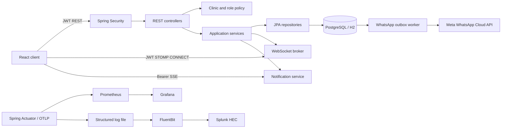

# ClincyAnywhere architecture

ClincyAnywhere is a modular Spring Boot API with a React client. The backend uses controller, DTO, service, repository, entity, mapper, and event-listener boundaries. Controllers validate HTTP inputs and delegate; services enforce clinic/role rules and transaction boundaries; repositories own persistence queries; entities stay out of API responses. The frontend centralizes authenticated REST calls in `frontend/src/lib/apiClient.js` and keeps the bearer token in memory.

## Request and data flow

## Backend boundaries

- `controller`: REST resources, authentication principal extraction, HTTP status mapping.
- `dto`: validated request and response records; no JPA entities cross the API.
- `service`: use cases, authorization policy calls, transaction boundaries, retry and provider behavior.
- `repository`: JPA persistence, paged and locked work selection.
- `entity`: persistence models with audit timestamps from `BaseEntity`.
- `mapper`: record payload conversion.
- `common.exception`: consistent JSON error responses.
- `aop`: operation timing and result logs without request bodies or patient content.
- `config`: Spring Security, CORS, bounded executors, scheduler, and realtime broker.

## Security and communication

REST uses short-lived signed JWTs over TLS in deployment. Stateless Bearer authentication permits disabling CSRF for the JSON API. CORS uses an explicit origin allowlist. Clinic data requests are checked against persisted clinic memberships; the platform owner can explicitly select any registered clinic as a global administrator. Onboarding teammates remain limited to their cross-clinic lead workflow. Demo memberships exist only in `dev`/`test`. Patient accounts are created from one-time, 24-hour invitations bound to a specific patient record. A patient can read only that record and may message clinic doctors/admins. Doctors/admins can invite patients and communicate with invited patient accounts.

Direct messages are persisted before delivery. An application event is published in the transaction and a transactional listener dispatches WebSocket/SSE notifications after commit. WebSocket STOMP requires a JWT in `CONNECT`, permits only private user queue subscriptions, and rejects client publications. SSE notifications are persisted, scoped by clinic/user, replayable with `Last-Event-ID`, and retained for 30 days. The Compose stack enables a RabbitMQ STOMP relay for cross-instance WebSocket destinations and RabbitMQ fanout for SSE emitters. SSE replay state remains in PostgreSQL; validate broker availability, reconnect behavior, and sticky/shared routing as part of deployment.

WhatsApp delivery is opt-in. API requests require doctor/admin role and a consent confirmation; messages enter a Liquibase-managed outbox with the requesting account and consent-confirmation timestamp. Workers claim rows under a short pessimistic-lock transaction, make network requests outside the transaction on a bounded executor, apply bounded retry/backoff, and keep terminal status. The Meta adapter has timeouts and a circuit breaker. SSE/WebSocket events inform the requester of outbox outcomes. Provider delivery is at-least-once; verified webhooks and independently verified consent evidence are required before patient use.

Clinic invoice payments use a separate payment ledger linked to the existing encrypted billing records. Cash receipts and Razorpay orders update the invoice under a row lock; gateway orders and signatures are verified server-side, and captured/failed webhooks are HMAC-checked and applied idempotently. Razorpay keys and webhook secret are server-only configuration, and online checkout remains disabled until all three are present. Do not hold database transactions across Razorpay network calls.

## Persistence and operations

Liquibase owns schema evolution; Hibernate validates the schema at startup. JPA service methods use explicit transaction boundaries. Cache keys include clinic and record category. Async and scheduled execution use bounded, named pools with backpressure, MDC context propagation, and graceful shutdown. HTTP failures use RFC 7807 problem details with a correlation ID; logs do not include request bodies or patient content. Avoid holding database transactions while waiting on external providers.

Profiles are `dev`, `test`, and `prod`. Demo data/users are restricted to `dev`/`test`. Production requires PostgreSQL, secret-managed JWT and database credentials, explicit CORS origins, and a one-time platform-owner bootstrap that must be disabled after first startup. Legacy clinic-admin bootstrap is disabled; create the first clinic admin by converting an authorized onboarding lead. JVM container memory percentages, G1GC, and GC logs are in the Docker entrypoint.

Actuator health/readiness and Prometheus metrics are served on the internal production management port. Prometheus scrapes that endpoint; Grafana is provisioned with Prometheus and an API/JVM dashboard. OTLP traces/metrics go to the collector. Structured API log files can be forwarded with the optional Fluent Bit Splunk HEC profile.

## Local verification

Run `cd backend && mvn test`, `cd frontend && npm run build`, and `cd frontend && npm run test:e2e` with the demo API running for API-backed browser coverage. Treat the latest dated section in `runtime-validation-report.md` as current evidence; older sections are historical. For a local production-like dependency stack, copy `.env.example` to `.env`, set the required secrets, then run `docker compose up --build`. Add `--profile splunk` after setting Splunk HEC values.

## Production readiness controls and release gates

Implemented in this repository:

- AES-256-GCM encryption for care-record payloads, direct-message bodies, and WhatsApp recipient/message fields. Production requires `APP_DATA_ENCRYPTION_KEY` and a separate stable `APP_PHONE_FINGERPRINT_KEY` (both base64, exactly 32 random bytes); keep them in a secret manager outside PostgreSQL. Startup migrates legacy plaintext rows in bounded batches. Backups and restores must retain the matching key versions. Online dual-key rotation is not implemented.
- Record read/list/create/update/delete audit metadata is written to `record_audit_events`, including clinic, actor, action, record identifier, timestamp, and correlation ID. Payloads are intentionally excluded. [`ops/archive-audit.sh`](ops/archive-audit.sh) exports closed months encrypted to an S3 Object Lock COMPLIANCE bucket. The operating organization must approve retention dates, configure the bucket and scheduler, and test recovery; the application does not purge audit rows.
- Existing SSE notification rows are purged after 30 days. This is not a general patient-record retention policy.
- The Compose edge applies IP-based request and connection limits to login, registration, and public onboarding. Production must put the edge behind trusted TLS and configure trusted proxy IP handling. If multiple edge replicas are used, shared rate-limit state or equivalent managed WAF controls are required.
- Meta webhook GET challenge and POST `X-Hub-Signature-256` validation use a constant-time comparison. Configure `WHATSAPP_APP_SECRET`, `WHATSAPP_WEBHOOK_VERIFY_TOKEN`, and the mapped `WHATSAPP_CLINIC_ID`. Provider message IDs and idempotent `sent`/`delivered`/`read`/`failed` receipts are persisted, and outbox state is reconciled. Sending requires an active consent event with an external evidence reference; verified inbound `STOP`/`UNSUBSCRIBE`/`END`/`CANCEL`/`QUIT` messages revoke consent and suppress queued sends. Release owners still must validate the consent language, evidence source, and operational opt-out process.
- STOMP can connect to an external broker relay with `STOMP_RELAY_*` settings. Production horizontal scale requires a managed HA broker. SSE connections remain process-local and need sticky routing or a shared event fan-out implementation.
- Encrypted `pg_dump` automation and isolated restore drill procedures are in [`ops/backup.sh`](ops/backup.sh) and [`ops/backup-restore.md`](ops/backup-restore.md). A script/runbook is not evidence that a target environment has scheduled backups or passed a restore drill.
- The `prod` profile fails startup unless `PRODUCTION_RELEASE_GATES_APPROVED=true` and `PRODUCTION_RELEASE_EVIDENCE_REF` is populated after the release checklist has been approved.

Before any real-patient production use, complete [`docs/PRODUCTION-RELEASE-GATES.md`](docs/PRODUCTION-RELEASE-GATES.md) with evidence for: TLS and network isolation; managed secret and encryption-key recovery; scheduled encrypted off-site backups and a successful restore drill against RPO/RTO; external HA broker and SSE scale strategy; abuse limits at every public ingress; audit retention, access, and immutable archival; patient identity proofing; independently recorded consent and opt-out handling; verified provider webhook delivery receipt processing; incident response and access review; clinical safety validation, privacy/regulatory assessment, and accountable governance approval. Those environment-specific controls and approvals cannot be certified by repository code alone. Until the evidence is approved, keep real-patient workloads and WhatsApp delivery disabled.
